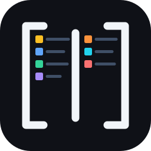
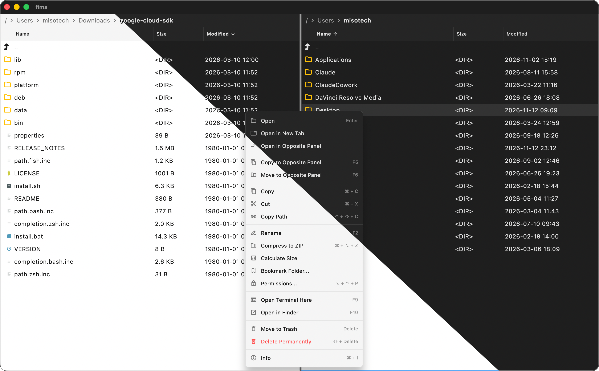

<p align="center">
  
</p>

<h1 align="center">fima</h1>



Fima is a modern, two-panel file manager built with Flutter, designed specifically for **programmers** who prefer keyboard-centric workflows. It is a cross-platform desktop application available for Linux, Windows, and macOS.

## Download

Download the latest [nightly build](https://github.com/spajdo/fima/releases/tag/nightly) (automated daily build):

| Platform | Portable | Installer |
|----------|----------|-----------|
| **Linux** | [fima-nightly-linux.zip](https://github.com/spajdo/fima/releases/download/nightly/fima-nightly-linux.zip) | [fima-nightly.deb](https://github.com/spajdo/fima/releases/download/nightly/fima-nightly.deb) |
| **Windows** | [fima-nightly-windows.zip](https://github.com/spajdo/fima/releases/download/nightly/fima-nightly-windows.zip) | [fima-nightly-setup.exe](https://github.com/spajdo/fima/releases/download/nightly/fima-nightly-setup.exe) |
| **macOS** | [fima-nightly-macos.zip](https://github.com/spajdo/fima/releases/download/nightly/fima-nightly-macos.zip) | [fima-nightly.dmg](https://github.com/spajdo/fima/releases/download/nightly/fima-nightly.dmg) |

## Key Features

- **Keyboard First**: Navigate and control the entire application without leaving the keyboard.
- **Two-Panel Layout**: Classic dual-pane interface for efficient file management.
- **Indexing paths**: 
- **Cross-Platform**: Runs natively on Linux, Windows, and macOS.
- **Modern UI**: Clean and minimal interface with support for dark and light themes.
- **Support tabs**: Open multiple directories in different tabs.
- **Workspaces**: Create dedicated workspaces for different projects and switch between them instantly.
- **Bookmarks**: Save frequently accessed directories for quick navigation.
- **Remote connections**: Save and manage remote connections via SSH (supports copy/paste between local opposite panel).
- **Fully Customizable**: Remap any keyboard shortcut to match your personal workflow.

## Shortcuts

Maximize your productivity with these essential shortcuts:

| Action | Windows / Linux | macOS |
|--------|----------------|-------|
| **Go to File** | `Ctrl` + `P` | `Cmd` + `P` |
| **Command Palette** | `Ctrl` + `Shift` + `P` | `Cmd` + `Shift` + `P` |
| **Workspaces** | `Ctrl` + `Shift` + `W` | `Cmd` + `Shift` + `W` |
| **Remote connections** | `Ctrl` + `R` | `Cmd` + `R` |
| **Bookmarks** | `Ctrl` + `B` | `Cmd` + `B` |

## Getting Started

To run the application from source:

```bash
# Get dependencies
flutter pub get

# Run the app
flutter run
```
